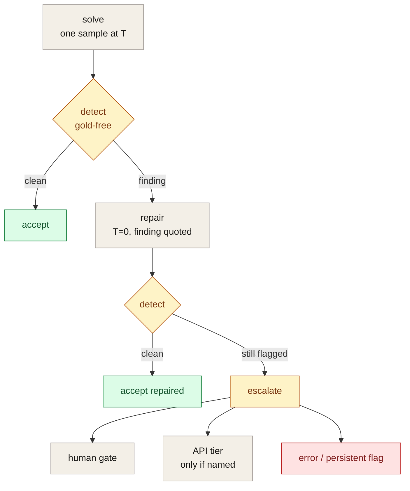
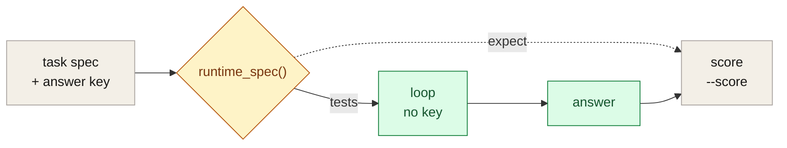
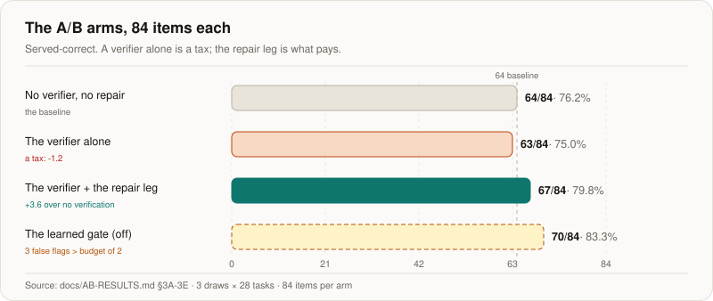
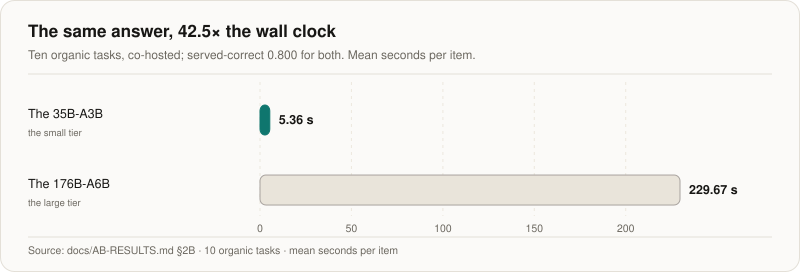
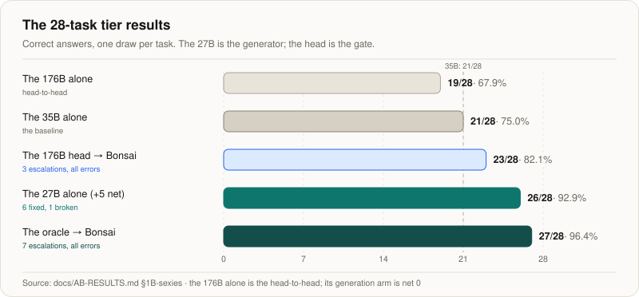
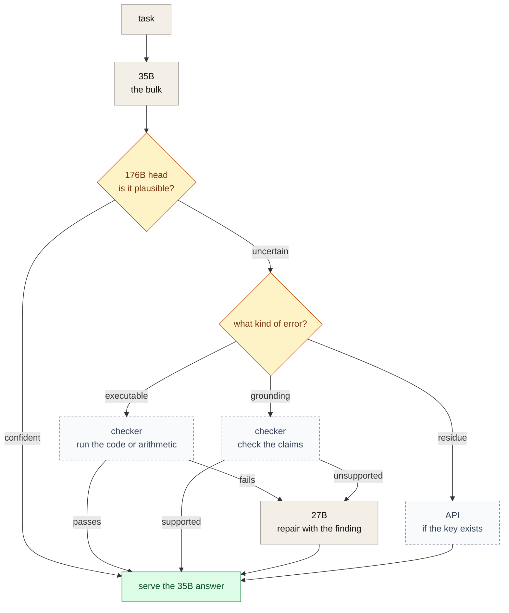

# The Hive Cascade: detect → repair → escalate

**A gold-free verification-and-repair loop for local language models.**

A model that is wrong is rarely *uncertain* - it is confidently wrong, and the
confidence is indistinguishable from the confidence of a right answer. Every
LLM application inherits this problem: a wrong answer costs the same as a
right one, unless something checks it.

The Hive Cascade is a serving loop that checks every answer before it is
served, repairs what can be repaired, and escalates what cannot - using
**verifiers that never see the answer key**.

This is the paper: the method, the protocol, the measured results, and the
negative results I kept. The code is in
[the repository](https://github.com/sky-is-green/hive); the task sets and
the run reports are in the
[hive-cascade dataset](https://huggingface.co/datasets/SkyIsNotGreen/hive-cascade);
the visual companion is
[the Space](https://huggingface.co/spaces/SkyIsNotGreen/hive-cascade-paper).
The measurements are current to October 2026; the checker and the API driver
are unmeasured. The live status is in the [STATUS document](../docs/STATUS.md).

**Contents**

- [The claim in one page](#the-claim-in-one-page)
- [1. The problem](#1-the-problem)
- [2. The method](#2-the-method)
  - [The gold-free runtime contract](#the-gold-free-runtime-contract)
- [3. The taxonomy: what a hive is made of](#3-the-taxonomy-what-a-hive-is-made-of)
- [4. The measured results](#4-the-measured-results)
  - [4.1 The tiered refresh](#41-the-tiered-refresh-the-two-scions-measured-side-by-side)
  - [4.2 The escalation tier](#42-the-escalation-tier-the-176b-buys-nothing-the-27b-buys-five)
- [5. The learned gate: a negative result I kept](#5-the-learned-gate-a-negative-result-i-kept)
- [6. The escalation lane: the harvest](#6-the-escalation-lane-the-harvest)
- [7. The reporting](#7-the-reporting)
- [8. The router is the product](#8-the-router-is-the-product-the-cascade-is-symmetric)
- [9. What is not claimed](#9-what-is-not-claimed)
- [10. Reproduce](#10-reproduce)
- [11. License](#11-license)

## The claim in one page

The harness, not the model, is the lever on this class.

| the measurement | what it compares | the result |
|---|---|---|
| the 35B, three draws (84 items per arm) | no verifier vs the verifier and the repair leg | 64/84 (76.2%) → **67/84 (79.8%)** |
| the 35B, one draw (28 tasks) | the model vs the loop, same draw | 23/28 (82.1%) → **24/28 (85.7%)** |
| the escalation candidate (28 tasks) | the 35B vs the 27B alone | 21/28 (75.0%) → **26/28 (92.9%)**, +5 net |
| the generation arm (28 tasks) | the 35B vs the 176B answering again | 21/28 (75.0%) → 21/28 (75.0%), net 0 |

The 23/28 and the 21/28 are different draws; the three-draw arms are the
robust comparison. The 27B's +5 is 6 errors fixed and 1 correct answer
broken. The generation arm's net 0 is 2 fixed and 2 broken on the 35B's
answers; the 176B alone was 19/28 in the head-to-head.

Three results carry the paper:

1. **Verification needs repair.** A verifier alone is a tax: 63/84 against
   64/84 without one. The repair leg makes verification pay: 67/84, +3.6
   points over no verification, with 8 of the 9 catches cleared. It catches
   8 wrong answers for every 1 correct answer it drops.
2. **The tier is not the model.** The 176B's generation is net zero at
   20.68 s an item. A 27B dense model fixes 6 of the 7 errors for +5 net at
   8.92 s. The 176B's head is a cheap judge (2.52 s a verdict, 0 of 21
   correct answers sent up), and the 27B is the escalation generator.
3. **Checkability comes before competence.** The head gives four of the
   seven errors `p >= 0.97`; they are arithmetic and code, which a sandbox
   can settle and a reader cannot. The checker is the next build; it is not
   yet measured.

What is not claimed: that this generalises beyond this class, or that the
checker and the API driver have been measured. They have not.

---

## 1. The problem

Self-verification in language models is usually a model asking itself whether
its answer is right, and a judge asking the same. Both are unreliable in the
same direction: the failure modes of a generator and a judge trained on the
same distribution are correlated, so the cases that are hardest for the
generator are usually the cases the judge waves through.

Two facts make the problem sharper:

1. **The detector is not the generator.** A wrong answer that is internally
   inconsistent (the arithmetic does not add up) or whose code does not pass
   the task's own tests is detectable by *running something*, not by asking a
   model. A 176B model's arithmetic slip is caught by a calculator.
2. **The check must not be the answer key.** If the verifier compares the
   answer to the expected answer, the loop is a benchmark, not a system. It
   cannot run in production, where there is no expected answer, and it
   cannot measure anything, because the detector is then trivially perfect.

The cascade is built around those two facts.

## 2. The method

Per item, the loop is four stages:



*Figure 1. The loop. Detect and repair are the local path; escalation is the exception, not the default.*

**solve.** One request to the local model at the run's temperature. A draft
that hits the token cap is **not an answer**: it retries once at double the
budget, and a still-truncated draft escalates rather than being scored as a
wrong answer.

**detect.** Gold-free findings, reported as *findings* (the false equation,
the traceback) rather than as a probability:

| detector | what it checks | needs |
|---|---|---|
| `consistency` | the answer contradicts itself (the arithmetic in the derivation does not add up) | nothing |
| `code_exec` | the code does not pass **the task's own tests** | a test block in the task |

That is the whole detector set. `numeric_gold` and `choice_made_gold` exist
for scoring, and the loop never calls them.

**repair.** One re-attempt with the finding quoted, at temperature 0 (the
strongest local re-attempt; a greedy re-ask is not a second sample, it is a
correction). Three rules keep the loop honest:

- a truncated attempt retries once at double the budget and is otherwise
  **never accepted** as the answer;
- a byte-identical attempt **stops** the loop (the model is not going to
  change its mind);
- an attempt that clears the detectors is re-framed to the task's interface
  (`\boxed{…}`, `Final answer: n`, a letter, a fenced block) and becomes the
  served answer - framing only, never content.

**escalate.** Still flagged, or nothing consumable extracted → the human gate
(verbose on the first trigger, compact afterwards) → solve locally again
(`keep` is a sub-option of solve) or escalate to the API tier. There is no
API tier until a provider is named: the escalation lane is a policy, not a
default.

Verdicts: `accepted`, `accepted_repaired`, `escalated`, `error`.

### The gold-free runtime contract

This is the part that makes the rest measurable.

Every task spec carries a `checker`. For a gold-dependent task that checker
has an `expect` field - **the answer key**. The loop is never allowed to see
it. Specs pass through one function:

```python
def runtime_spec(spec: dict) -> dict:
    """Everything the loop is allowed to know: the answer frame and the task's own tests."""
    ck = spec.get("checker") or {}
    rs = {"kind": ck.get("type")}
    for key in ("tests", "prelude", "footer"):
        if key in ck:
            rs[key] = ck[key]
    if any(word in key for key in rs for word in GOLD_WORDS):
        raise AssertionError(f"gold-shaped key reached the loop: {sorted(rs)}")
    return rs
```

The implementation is [`runtime_spec` in `experiments/cascade/cascade.py`](../experiments/cascade/cascade.py). `expect` is dropped here, and the function raises if a gold-shaped key ever
reaches the loop. So no stage - detect, repair, canonicalise, gate - can
read the answer key even by accident. Gold-based scoring is a **separate
post-loop step** ([`--score`](../experiments/cascade/run_cascade.py)), never
consulted by the loop.



*Figure 2. The gold-free contract. The loop gets the frame and the tests; only the post-loop score sees `expect`.*

The consequence: the loop is the same code on a task whose answer key you
have and on one you do not, and the measured improvement is a property of
the serving loop, not of the benchmark.

## 3. The taxonomy: what a hive is made of

A serving system for local models is a set of *roles* and the *paths* between
them. The cascade ships the taxonomy explicitly (22 roles, A1-H1) in
[`harness/cascade/roles.py`](../harness/cascade/roles.py):

| group | roles | what they do |
|---|---|---|
| **A** - perception | A1 embedding, A2 vision | encode the input |
| **B** - knowledge | B1 retrieval, B2 reranking, B3 late interaction, B4 curation | find and prune what matters |
| **C** - control | C1 routing, C2 gating, C3 next-step, C4 scoring | decide what happens next |
| **D** - verification | D1 consistency, D2 accept/reject | check the answer |
| **E** - generation | E1-E4, by size | write the answer |
| **F/G/H** - escalation, latency, audit | the ladder, the budgets, the trail | keep the record |

and the seven **paths** (P0-P6) in
[`harness/cascade/paths.py`](../harness/cascade/paths.py) that compose them:

| path | trigger | shape |
|---|---|---|
| P0 | a near-duplicate prompt | cache lookup only, no generation |
| P1 | easy prompt, high route confidence | small generator, escalate to P3/P5 |
| P2 | normal question | route → gate → retrieve → rerank → generate → verify |
| P3 | low confidence, or the verifier rejects | P2's stages, then a larger generator |
| P4 | code or tool request | the tool loop, verification pipelined |
| P5 | hard reasoning | the largest local model, capped |
| P6 | image input | vision encode → generate → verify |

The point of the taxonomy is not the diagram. It is that **each role has a
measured latency band and a device class**, so a path can be costed before
it is run, and a slow role can be moved off the hot path (the router and the
consistency check are async in P2).

## 4. The measured results

### The 66-item organic set

The organic set: 66 items, sampled at T=0.7, live against the local 176B
(A6B ternary, MoE); the run bundle is in
[`experiments/cascade/results/cascade-e2e-sampled-20261018/`](../experiments/cascade/results/cascade-e2e-sampled-20261018/).
The bench: GSM8K-style arithmetic, HumanEval-style code, and a multiple-choice
set.

| | items | served-correct | false rejects (ledger) | note |
|---|---|---|---|---|
| no cascade (sampled) | 66 | 58 | - | the baseline |
| **+ detect + repair** | 66 | **62** | **0** | 6 of the 9 wrong answers detected; 4 of the 5 seen live repaired |
| no cascade (greedy) | 66 | 65 | - | the greedy regime is nearly clean |
| **+ detect + repair (greedy)** | 66 | 65 | 0 | 0 detections - the loop is a no-op |

**Reading the greedy row honestly.** At temperature 0 the bench is nearly
clean, so the loop has nothing to do. Sampling is the cascade's dial: the
cascade earns its keep exactly where the model's own distribution is
uncertain. A deployment that runs greedy gets nothing from this machinery -
that is a result, not a failure, and it is why the sampled regime is the
one reported first.

**The escalation ledger's false-reject count is zero.** The 66-item runs
record no false reject in the runner's ledger: the `false_reject` field only
exists once something escalates, and nothing did. That is not the verifier's
own rate - a rejected answer that was right - which the later three-draw
campaign measures at 1, 1 and 3 across its arms
([§5](#5-the-learned-gate-a-negative-result-i-kept)). The trade is still worth
making: the verifier catches 8 wrong answers for every 1 correct answer it
drops.

**Repairs do not harm correct answers.** The repair leg is only entered on a
rejection, and a cleared attempt is re-framed, never rewritten.

**Truncation is caught by the ladder.** The runner's own
[sampled](https://huggingface.co/datasets/SkyIsNotGreen/hive-cascade/blob/main/results/runner-cascade-sampled-20261018-report.json)
and [nothink](https://huggingface.co/datasets/SkyIsNotGreen/hive-cascade/blob/main/results/runner-cascade-sampled-nothink-20261018-report.json)
reports recorded 3 truncations caught and flagged, and 0 ledger false rejects
in both.

### 4.1 The tiered refresh: the two Scions, measured side by side

The 2026-10-18 numbers above come from the 176B alone. The question the
tiered design actually poses is *which tier does the work*, so both
[Scion models](../docs/AB-RESULTS.md#1a-the-two-scions-head-to-head) were served at
once - on one card, sharing it - and run over the same
[28 organic tasks](../experiments/cascade/tasks-organic-28.json).

#### The head-to-head

The two models, one draw each (T=0.7, 640 tokens, 62 minutes wall, 0 errors;
[`experiments/cascade/results/dual-scion-20261020/full28/`](../experiments/cascade/results/dual-scion-20261020/full28/)):

| | the 35B-A3B | the 176B-A6B |
|---|---|---|
| correct (the task's own checker) | **21/28** | 19/28 |
| the weight | 11.3 GB | ~132 GB |
| latency, median (under co-hosting) | 84.9 s | 93.9 s |
| latency, p90 | 189.5 s | 213.5 s |

They are **equivalent on this class within noise** - the split on the
disagreements is 8 to 6 - and the 176B is twelve times the weight. They
also **disagree on 16 of 28**, so neither dominates: the disagreement is
the raw material for an arbiter, and a router that knows *which* model to
trust per item is worth more than either model alone.

#### The cascade over the 35B

The same 28 tasks, a fresh draw, the deterministic judge and the repair leg
on (T=0.7):

| | |
|---|---|
| the model's own accuracy | 0.821 (23/28) |
| **the cascade's served-correct** | **0.857 (24/28)** |
| the repair leg | 1 attempted, **1 cleared** |
| **false rejects (ledger)** | **0** |
| false accepts | 4 (0.143) |
| the mean per-item latency | **6.9 s** |

The loop does its job on the small tier: one wrong answer caught and
repaired, nothing false-rejected in the ledger, and the served answer is
better than the model's own.

#### The multi-sample arms

The same 28 tasks and the 35B, three draws each - 84 items per arm, because
a single draw is a direction and not a measurement:

| arm | served-correct | the verifier rejected | of which false | the repair leg |
|---|---|---|---|---|
| no verifier, no repair | 64/84 (76.2%) | - | - | - |
| the deterministic verifier, no repair | 63/84 (75.0%) | 6 | 1 | - |
| the verifier + the repair leg | 67/84 (79.8%) | 9 | 1 | 8/9 cleared |
| + the learned gate | 70/84 (83.3%) | 12 | 3 | 8/11 |



*Figure 3. The A/B arms. The verifier alone is a tax; the repair leg pays. The learned gate improves the number but stays off by its pre-registered rule. The full table is [`AB-RESULTS.md` §3A-3E](../docs/AB-RESULTS.md#3a-3e-the-cascades-own-arms-measured-on-the-35b).*

**A verifier on its own is a tax: -1.2 points.** It catches the wrong
answers and, with no repair leg, they are simply not served. **The repair
leg is what makes verification pay: +4.8 points over the verifier alone,
+3.6 over no verification at all** - 8 of the 9 catches cleared. The gate
adds +3.5 more, at the cost of 3 false flags against its pre-registered
budget of 2 (so it stays off - see
[§5](#5-the-learned-gate-a-negative-result-i-kept)).

And the trade is worth making: the verifier catches **8 wrong answers for
every 1 correct answer it drops**.

#### The comparable pair

The same [10 organic tasks](../experiments/cascade/tasks-organic-10.json), the
same cascade, the same verifiers, the two models:

| | the 35B-A3B | the 176B-A6B |
|---|---|---|
| the model's own accuracy | 0.800 | 0.800 |
| **the cascade's served-correct** | **0.800** | **0.800** |
| the false rejects (ledger) | **0** | **0** |
| the accepted-and-wrong | 2 | 2 |
| the repairs | 0 | 0 |
| **the mean per-item latency** | **5.36 s** | **229.67 s** |
| the mean tokens | 329 | 745 |



*Figure 4. The same answer, 42.5× the wall clock. The 35B and the 176B serve the same 0.800 on the 10 tasks; the 176B spends 42.5× the seconds. The table is [`AB-RESULTS.md` §2B](../docs/AB-RESULTS.md#2b-the-membranes-operating-points-hypothesis-h).*

**Identical outcomes, 42.5x the wall clock.** The same served-correct
(0.800 both), the same ledger false rejects (0 both), the same wrong-accepted (2
both), the same repairs (none needed in either) - and the 176B spends
2.3x the tokens thinking and 42.5x the seconds getting there (5.4 s an
item against 229.7 s).

On this class the small tier is not a compromise: **it is the same
answer, faster and twelve times lighter.** What the large tier buys is
the 8 items of the head-to-head where it was right and the small one was
not - which is what an arbiter would be for, and not what a bigger model
is for. The tiering design says exactly this: the small tier takes the
work, and the large one is the exception, not the default.

**What this does and does not say.** The tier comparison is one draw per
task and 28 tasks; the multi-sample arms above are three draws each. One
class (arithmetic, code, multiple choice), and the latencies are measured
under co-hosting - so they are the numbers a tiered deployment sees, not
the isolated ones. The tiering claim that survives this measurement is
narrow and worth stating exactly: **on this class the small tier can take
the work outright**, and the value of the large tier is not accuracy but
the 8 items where it was right and the small one was not - which is
exactly what an arbiter would be for.

### 4.2 The escalation tier: the 176B buys nothing, the 27B buys five

The 229.7 s above is not a property of the model. The same engine's log
says the 176B decodes at **67.7 tok/s** over the 4,424 generations it has
served. It is bimodal, and the engine says which mode it is in: a fresh
prompt read costs 5 tok/s, a reused prefix 71 tok/s, and the cold phase
is the OS pulling the model's expert weights off the NVMe ("the OS read
96842 MB from storage"). Warm and alone, the same 28 tasks cost **26.9 s
an item** - so the 42.5x gap was about 7x contention and a cold cache and
about 6x the tier (7 × 6 ≈ 42).

That leaves the question the campaign never asked: **what is the
escalation tier worth?** The tier asked the 176B to *answer again*. Both
arms were then measured on the same 28 tasks, the same 35B answers, the
same 176B - the arms separately, because interleaving them makes each
inherit the other's expert cache:

| | the generate arm | the judge arm |
|---|---|---|
| what the 176B does | answers again | reads the 35B's answer |
| the cost for 28 items | 579.1 s | **129.8 s** |
| the mean per item | 20.68 s | **4.64 s** |
| the errors it fixes | 2 of 7 | 2 of 7 (found) |
| the correct answers it breaks | 2 of 21 | **0 of 21** |
| the net | **+0** | - |

**The generation arm is worth nothing on this class.** Scored with the
tasks' own checkers, the 176B's fresh answer fixes 2 of the 35B's 7
errors and breaks 2 of its 21 correct ones: net zero, at 20.68 s an item.

**The generator, not the tier.** The same generate arm on a 27B dense model
([Bonsai 2](https://huggingface.co/prism-ml/Ternary-Bonsai-2-27B-gguf),
ternary, 7.2 GB) fixes 6 of the 7 errors and breaks 1 of the 21 correct:
**net +5 at 8.92 s an item**, against the 176B's net zero at 20.68 s. The
176B is a judgement model; its generation is not better than the 35B's. The
tier was never worthless - the 176B was the wrong occupant. Gated by the
head at its best threshold, the same loop reaches 23/28 (3 escalations, all
errors, none correct) against the oracle gate's 27/28; the head's four
misses are plausible answers at `p >= 0.97`, which is why the next tier is a
*checker*, not a better judge
([`AB-RESULTS.md` §1B-sexies](../docs/AB-RESULTS.md#1b-sexies-the-escalation-generator-a-27b-dense-not-the-176b)).



*Figure 5. The tier results. The 27B is the generator; the head is the gate. The 176B alone is the head-to-head; its generation arm is net zero.*

**The judge arm is the same model, reading itself.** The 176B has a
decision head - the last prompt token's hidden state, read through the
engine's `emb=` as a *prefill* - and the head is in my own published
dataset
([`SkyIsNotGreen/decision-heads`](https://huggingface.co/datasets/SkyIsNotGreen/decision-heads)).
It was re-verified before use:
the AUC on its own frozen test split recomputes to 0.9941 (the published
0.9941), and the live engine agrees with the stored states to within
0.027. On the 35B's answers the head reads at AUC 0.864, and at p < 0.5
it flags 2 of the 7 errors while keeping 21 of the 21 correct answers.

So the tier's honest options are: **ask the 176B to answer** (20.68 s an
item, net zero), **ask it to judge** (4.64 s an item, 2 errors found and
none broken), or **ask the 35B and stop** (6.68 s an item, the 35B's own
accuracy). The judge arm is 4.5x cheaper than the generation arm and is
the only one of the three with a positive expected value on the errors.

**The caveat is the filter's, not the head's.** It found 2 of 7 errors,
not 7. The right shape is the two together - judge first, generate only
for what the judge sends up - which on this set is 2 generations out of
28. And the head's own dataset says the *in-domain* community head
should beat the frozen one on this body; on this task set it does not
(AUC 0.782 against 0.864, and it keeps five fewer correct answers at
0.90), so the frozen head is the one to ship here - the dataset's own
"validate per model" caveat, in action.

**What this changes.** The cascade's escalation tier was paying 20.68 s
(230 s co-sited) for an answer that was no better than the one it
replaced. It is now a 4.64 s judgement, and the runner carries the option
([`--verdict-url`](../experiments/cascade/run_cascade.py)).

## 5. The learned gate: a negative result I kept

The deterministic detectors have a measured blind spot: answers that are
*internally consistent and wrong*. A third trigger - a small learned head
over the draft - was built, fitted, wired and measured
([`harness/cascade/learned_gate.py`](../harness/cascade/learned_gate.py)).

It works: the intern-decision-0.8B readout on the CPU reproduces the stored
fitted probability exactly from the committed states/heads, and the live
extraction cross-check reproduced the flagship catch at p=0.073751.

And it **stays off by default**, by its own pre-registered rule:

| measurement | result |
|---|---|
| fresh silent-wrong catches | +1 |
| false flags | 3 (budget: ≤2) |
| wall clock | +8.7% |
| verdict | **3 false flags > the pre-registered ≤2 budget → the gate is off** |

Three independent measurements agreed that no 0.8B head separates on the
silent distribution. A gate that fires more often than it should is a tax on
every answer to catch one mistake; at this precision it is not worth it. The
implementation is tested and available as
[`--gate intern-0.8b`](../harness/cascade/learned_gate.py), and the default is
off. **A negative result, pre-registered, is a result.**

### The later measurement

The [A/B campaign](../docs/AB-RESULTS.md#3c-the-learned-gate-on-the-35b) (2026-10-20;
the 35B-A3B, the same 28 organic tasks, three draws each, 84 items per arm)
confirms it:

| arm | served-correct | the gate | the mean |
|---|---|---|---|
| the gate off | 67/84 (79.8%) | - | 6.6 s |
| **the gate on (intern-0.8B)** | **70/84 (83.3%)** | fired 7: 4 true catches, **3 false flags** | 8.1 s |

The gate is worth **+3.5 points** - and it false-flags 3 times against
the pre-registered budget of 2, so **by its own rule it stays off**. The
single-draw arm of the same configuration had looked like a clean win (0
false flags in 56 items); at 84 items the false flags are back over the
budget. A single draw would have shipped it.

What is constant across both measurements: the gate **catches real
silent wrongs** (4 here, 1 there) and its false flags are exactly what
the budget exists to bound. The mechanism works; the head does not
separate well enough on this distribution to pay for itself.

### The correction to the zero

The same campaign corrected the earlier claim in
[§4](#4-the-measured-results): the "0 false rejects"
there is the *escalation's* bookkeeping, not the verifier's - the runner's
`false_reject` field only exists once something escalates. The verifier's
own false rejects (a rejected answer that was right) are **1, 1 and 3**
across the arms, and it catches **8 wrong answers for every 1 correct
answer it drops**. The trade is still worth making; the zero was never the
verifier's number.

## 6. The escalation lane: the harvest

Every run writes `escalation.jsonl` next to its report: one line per item
the ladder resolved - the task, the full draft, the structured detector
findings, the repair attempt, and the ladder's resolution (human answer, API
answer, or a persistent flag).

The serving loop appends and forgets; **nothing in the runtime reads it**.
That is deliberate: the gold-free runtime contract stays intact while the
lane feeds offline training. It is the seed for three consumers:

1. the **gate discriminator** - escalate a task, sample fresh local drafts on
   it, checker-label each against the escalated answer, and re-audit any head
   on the silent distribution before pre-registering a restart;
2. **repair SFT** on `(prompt, draft, finding, fixed answer)` triples;
3. **local-tier distillation** of API and human answers.

The lane is what turns a serving loop into a training-data pipeline without
touching the runtime's contract.

## 7. The reporting

A verdict nobody can trace is a rumour. Every run therefore leaves three
run artifacts, plus a model card generated from the manifest. They are
published in this repository.

**`report.json`** - the per-item record. For every item: the verdict
(`accepted`, `accepted_repaired`, `escalated`, `error`), the detector
findings (the false equation, the traceback), the repair attempt and its
outcome, the generations it took, the timing, and the ladder's
resolution. The summary block carries the served-correct count, the
repaired set, the blind spot and the detector tallies.

**`manifest.json`** - the provenance. The model's sha256, the stack, the
git commit, the task-set sha and the decode settings, plus the per-task
and per-benchmark aggregates with both the sample-accuracy and the
task-macro. A run can be reproduced because the manifest says what to
reproduce.

**`escalation.jsonl`** - the harvest: one line per item the ladder
resolved, carrying the task, the full draft, the structured findings, the
repair attempt and the resolution. The serving loop appends and forgets;
nothing in the runtime reads it, so the gold-free contract is untouched
while the lane feeds offline training.

**`MODEL-CARD.md`** - generated from the manifest, for the model page.

The point of the separation is that the *runtime* evidence (what the
verifiers caught, what the repair fixed, what the ladder did) and the
*evaluation* evidence (whether the answers were right) never mix. The
first is produced by the serving path with no access to the answer key;
the second is produced afterwards, with the key, and is never consulted
by the loop.

## 8. The router is the product: the cascade is symmetric

The protocol above is written local-first - the local model answers, the
judge gates, the API is the last resort - because that is the order the
campaign measured. The order is a *deployment* choice, not the
architecture. The same tiers can be driven from the other end: an API
orchestrator can call the local models as tools, and the routing table
is identical. What the system owns is the table - which tier can settle
which kind of task, at what cost and with what measured error - not the
direction the requests flow.

### The measured table

The same [28 organic tasks](../experiments/cascade/tasks-organic-28.json)
throughout:

| the tier | what it settles | the measured number | the cost |
|---|---|---|---|
| the 35B | the bulk | 21/28 (0.750) | the cheapest local |
| the 27B ([Bonsai 2](https://huggingface.co/prism-ml/Ternary-Bonsai-2-27B-gguf)) | the 35B's repairable errors | 26/28 alone (0.929); +5 net | 8.9 s/item |
| the 176B [head](https://huggingface.co/datasets/SkyIsNotGreen/decision-heads) | the *plausible* errors | AUC 0.864; 3 of 7 errors, 0 of 21 correct | 2.5 s/verdict |
| the [checker](HARNESS-CONTROLLER.md) | the *executable* errors | **not yet measured** | a sandbox call |
| the API | what nothing local settles | not yet measured (the key is expired) | per token |

The table says routing is not one axis. **Checkability comes before
competence**: four of the seven errors the 176B's head gave `p >= 0.97`
were arithmetic and code answers - a better *reader* cannot see them, and
a sandbox can. A router that sends every task to the strongest model is
buying tokens to solve problems that a `python -c` would have settled.



*Figure 6. The routing map. The head is measured; the checker and the API lane are designs, not runs.*

### The two drivers

- *The local driver* (the human in the Studio, or the local judge): start
  at the 35B; send up when a check fails or the judge is uncertain; end
  at the API when neither local tier settles it.
- *The API driver*: the frontier model plans and calls the local tiers
  as tools (`ask_local`, `run_checker`, `get_verdict`); the locals carry
  the bulk and the verification; the API pays for the plan and the
  residue.

The API driver needs exactly two things the local driver does not: a
tool schema over the existing endpoints, and a sandbox the checker can
call. Neither is a new model. The `--verdict-url` tier is already a
judge as a service; the checker is the same shape with an executor
behind it. The contract for the four tools, the invariants and the
bounded loop is in [`cascade/HARNESS-CONTROLLER.md`](HARNESS-CONTROLLER.md);
the survey of what other harnesses do is in
[`cascade/CONTROLLER-PRIOR-ART.md`](CONTROLLER-PRIOR-ART.md).

### What is not yet claimed

The API-driven direction has not been
measured at all: the paid tier's key is expired, and the checker is a
design, not a run. The table's local rows are measured; the two bottom
rows are the programme.

## 9. What is not claimed

- **Not** that the cascade fixes most wrong answers. In the 176B's
  66-item sampled run it caught 6 of the 9 wrong answers; in the greedy
  regime it caught 0.
- **Not** that a learned gate is useless. It is off because of *this* head on
  *this* distribution, at a *pre-registered* false-flag budget.
- **Not** that the measurements generalise. The first campaign is 66 organic
  items on the 176B; the tier campaign is 28 organic tasks on the 35B, the
  176B and the 27B, with one draw per task for the tier comparison and
  three draws per arm in the A/B. The task class is arithmetic, code and multiple
  choice. The priority plan is an evaluation floor first - a held-out split
  plus a real benchmark slice (GSM8K / MATH / HumanEval / TruthfulQA, local)
  at 3-5 samples per task, thresholds fitted on train and reported on test.
- **Not** that the taxonomy is complete. 22 roles is a map of what the
  measurements needed so far.

## 10. Reproduce

```bash
git clone https://github.com/sky-is-green/hive
cd hive && python -m pip install -r requirements-dev.txt
python -m pip install -e splinter

# the deterministic parts, no model needed
pytest tests/unit tests/integration -q

# the live loop against a local model
.venv/bin/python experiments/cascade/run_cascade.py \
    --tasks experiments/cascade/tasks-bench.json \
    --judge deterministic --repair auto \
    --api-fallback http://127.0.0.1:4000/v1     # optional; escalate, not needed to repair

# the console: every knob, one form
open http://127.0.0.1:8799/cascade
```

The runner is [`experiments/cascade/run_cascade.py`](../experiments/cascade/run_cascade.py);
the bench is [`experiments/cascade/tasks-bench.json`](../experiments/cascade/tasks-bench.json).
Runs land under
[`experiments/cascade/results/<run>/`](../experiments/cascade/results/):
`manifest.json`
(provenance - model sha256, stack, git commit, task-set sha, decode
settings - plus per-task and per-benchmark aggregates with sample-accuracy
and task-macro), `streams.json` (the full traces, regenerable), and a
generated `MODEL-CARD.md`. Manifests and cards are tracked in git; the large
stream traces are ignored.

## 11. License

MIT.

```
@misc{hive-cascade-2026,
  title  = {The Hive Cascade: detect, repair, escalate - a gold-free
            verification-and-repair loop for local language models},
  author = {sky-is-green},
  year   = {2026},
  url    = {https://github.com/sky-is-green/hive},
  note   = {Paper: https://github.com/sky-is-green/hive/blob/main/cascade/CASCADE-PAPER.md}
}
```

**Community invitation.** The protocol is written to be challenged: the
verdicts, the budgets and the pre-registration rules are all in the
repository, including the ones that failed. If your hardware produces a
different number, that is a result - open an
[issue](https://github.com/sky-is-green/hive/issues) with the run bundle.
